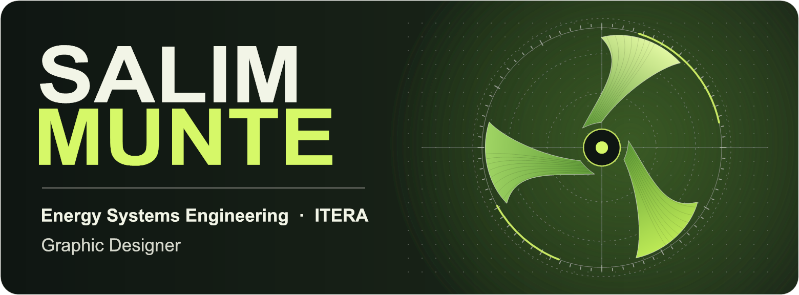
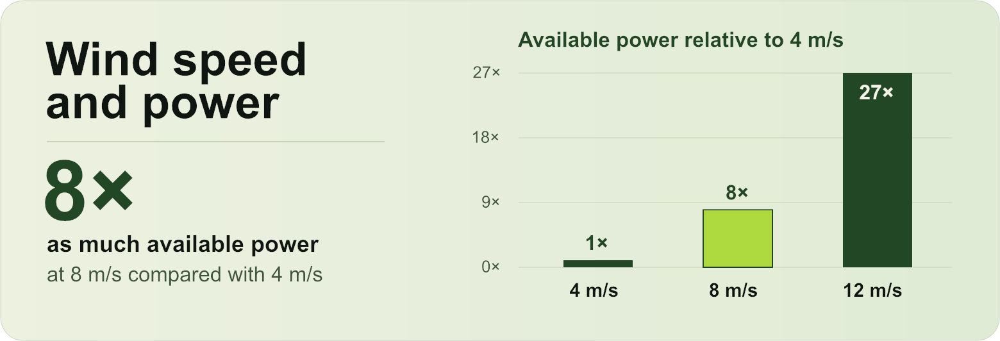

I'm **Salim Munte**, a graphic designer and Energy Systems Engineering student at [Institut Teknologi Sumatera (ITERA)](https://akademik.itera.ac.id/program-studi/teknik-sistem-energi). I'm interested in how energy moves through systems and how design can make those systems easier to understand.

## What I focus on

- **Energy systems engineering.** Renewable energy, energy conversion, and the factors that affect system efficiency.
- **Graphic design.** Typography, layout, and information design for presentations, diagrams, and other visuals that explain technical topics.

## Visual study · Wind speed and power

With air density and rotor swept area held constant, the power available in the wind rises with the cube of wind speed. The chart uses 4 m/s as a baseline. Doubling the speed to 8 m/s gives eight times the available wind power. Actual electricity output follows the turbine's power curve, which depends on its efficiency, controls, and rated power.

[Technical reference · U.S. Department of Energy, Understanding Wind Energy](https://www.energy.gov/sites/prod/files/2015/05/f22/Enabling%20Wind%20Power%20Nationwide_18MAY2015_FINAL.pdf)
